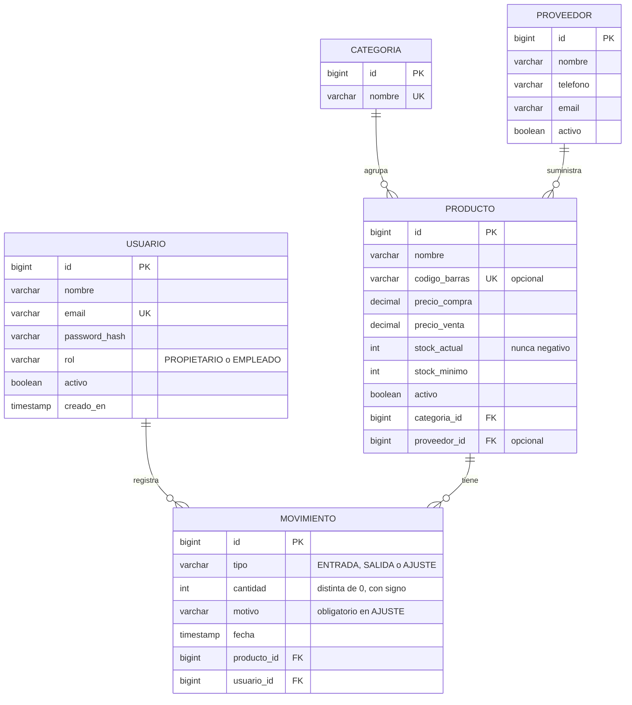

# Fase 2: Diseño (borrador)

Este documento se va completando por partes. Esta primera parte define el **modelo de datos**.

## 1. Modelo de datos

### 1.1 Diagrama entidad-relación

### 1.2 Tablas y atributos

**USUARIO**: personas que usan la app. Cada usuario tiene un rol.

**CATEGORIA**: agrupa productos (por ejemplo, "Ferretería", "Pintura"). El nombre no puede repetirse.

**PROVEEDOR**: a quién se compra. Es opcional en cada producto.

**PRODUCTO**: lo que se vende. Tiene dos precios (coste y venta), el stock actual y el stock mínimo para generar avisos. El `codigo_barras` es único, pero puede estar vacío, porque algunos productos no lo tienen.

**MOVIMIENTO**: cada cambio de stock. Es el registro histórico y la fuente de verdad de todo lo que ha pasado con un producto.

### 1.3 Decisiones de diseño

| # | Decisión | Motivo |
|---|---|---|
| D1 | `cantidad` se guarda **con signo**: positiva en ENTRADA, negativa en SALIDA, y en AJUSTE puede ser de cualquier signo | Así la suma de movimientos da el stock en cualquier momento, sin tener que mirar el tipo de cada fila |
| D2 | `stock_actual` se guarda en `PRODUCTO` además de existir en los movimientos | Consultar la lista de productos sería muy lento si hubiera que sumar todo el historial cada vez. Se actualiza en la **misma transacción** que el movimiento |
| D3 | `stock_actual` tiene una restricción `CHECK (stock_actual >= 0)` | Garantiza en la base de datos el requisito RNF-02, aunque la aplicación falle |
| D4 | Los precios usan `DECIMAL(10,2)`, nunca `FLOAT` | Los números de coma flotante redondean mal el dinero (por ejemplo, 0.1 + 0.2 no es exactamente 0.3) |
| D5 | Los productos y los proveedores se **desactivan** (`activo = false`), no se borran | Si se borraran, los movimientos quedarían sin producto (ver análisis, apartado 7) |
| D6 | `MOVIMIENTO` no se modifica ni se borra nunca | Es el registro de auditoría. Quién, cuándo y por qué quedan fijos |
| D7 | `rol` es un texto con valores fijos, no una tabla aparte | Solo hay dos roles. Una tabla extra complicaría el modelo sin aportar nada ahora |
| D8 | `codigo_barras` tiene restricción `UNIQUE` pero admite `NULL` | Varios productos sin código no deben chocar entre sí |

### 1.4 Reglas de integridad

1. Un movimiento de tipo **ENTRADA** tiene `cantidad > 0`.
2. Un movimiento de tipo **SALIDA** tiene `cantidad < 0`.
3. Un movimiento de tipo **AJUSTE** tiene `motivo` no vacío.
4. Ningún movimiento puede dejar `stock_actual` por debajo de 0. Si ocurre, la operación se cancela entera.
5. Cada cambio de stock (crear movimiento + actualizar `stock_actual`) se hace en **una sola transacción**.
6. Dos operaciones sobre el mismo producto no pueden leer el stock a la vez. Para eso se bloquea la fila del producto mientras dura la transacción (`SELECT ... FOR UPDATE`). Esto evita que dos salidas simultáneas dejen el stock en negativo.

> Las reglas 1 a 3 se comprueban en el servidor y, cuando es posible, también con `CHECK` en la base de datos. La regla 6 es la que más se pregunta en la defensa, así que conviene entenderla bien.
