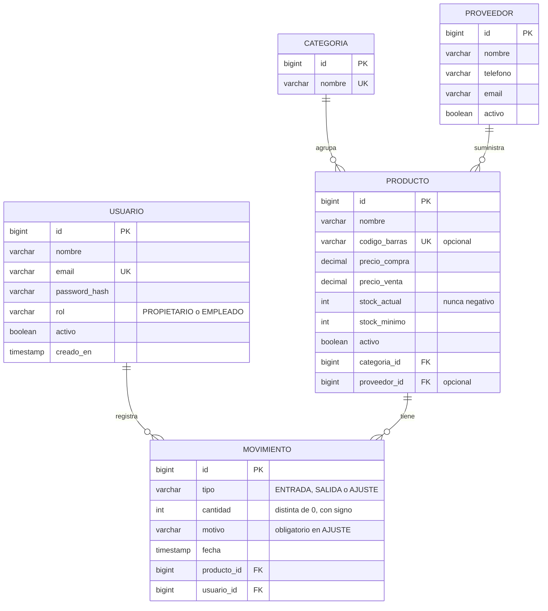

# Fase 2: Diseño (borrador)

Este documento se va completando por partes. Esta primera parte define el **modelo de datos**.

## 1. Modelo de datos

### 1.1 Diagrama entidad-relación

### 1.2 Tablas y atributos

**USUARIO**: personas que usan la app. Cada usuario tiene un rol.

**CATEGORIA**: agrupa productos (por ejemplo, "Ferretería", "Pintura"). El nombre no puede repetirse.

**PROVEEDOR**: a quién se compra. Es opcional en cada producto.

**PRODUCTO**: lo que se vende. Tiene dos precios (coste y venta), el stock actual y el stock mínimo para generar avisos. El `codigo_barras` es único, pero puede estar vacío, porque algunos productos no lo tienen.

**MOVIMIENTO**: cada cambio de stock. Es el registro histórico y la fuente de verdad de todo lo que ha pasado con un producto.

### 1.3 Decisiones de diseño

| # | Decisión | Motivo |
|---|---|---|
| D1 | `cantidad` se guarda **con signo**: positiva en ENTRADA, negativa en SALIDA, y en AJUSTE puede ser de cualquier signo | Así la suma de movimientos da el stock en cualquier momento, sin tener que mirar el tipo de cada fila |
| D2 | `stock_actual` se guarda en `PRODUCTO` además de existir en los movimientos | Consultar la lista de productos sería muy lento si hubiera que sumar todo el historial cada vez. Se actualiza en la **misma transacción** que el movimiento |
| D3 | `stock_actual` tiene una restricción `CHECK (stock_actual >= 0)` | Garantiza en la base de datos el requisito RNF-02, aunque la aplicación falle |
| D4 | Los precios usan `DECIMAL(10,2)`, nunca `FLOAT` | Los números de coma flotante redondean mal el dinero (por ejemplo, 0.1 + 0.2 no es exactamente 0.3) |
| D5 | Los productos y los proveedores se **desactivan** (`activo = false`), no se borran | Si se borraran, los movimientos quedarían sin producto (ver análisis, apartado 7) |
| D6 | `MOVIMIENTO` no se modifica ni se borra nunca | Es el registro de auditoría. Quién, cuándo y por qué quedan fijos |
| D7 | `rol` es un texto con valores fijos, no una tabla aparte | Solo hay dos roles. Una tabla extra complicaría el modelo sin aportar nada ahora |
| D8 | `codigo_barras` tiene restricción `UNIQUE` pero admite `NULL` | Varios productos sin código no deben chocar entre sí |

### 1.4 Reglas de integridad

1. Un movimiento de tipo **ENTRADA** tiene `cantidad > 0`.
2. Un movimiento de tipo **SALIDA** tiene `cantidad < 0`.
3. Un movimiento de tipo **AJUSTE** tiene `motivo` no vacío.
4. Ningún movimiento puede dejar `stock_actual` por debajo de 0. Si ocurre, la operación se cancela entera.
5. Cada cambio de stock (crear movimiento + actualizar `stock_actual`) se hace en **una sola transacción**.
6. Dos operaciones sobre el mismo producto no pueden leer el stock a la vez. Para eso se bloquea la fila del producto mientras dura la transacción (`SELECT ... FOR UPDATE`). Esto evita que dos salidas simultáneas dejen el stock en negativo.

> Las reglas 1 a 3 se comprueban en el servidor y, cuando es posible, también con `CHECK` en la base de datos. La regla 6 es la que más se pregunta en la defensa, así que conviene entenderla bien.

## 2. Casos de uso

### 2.1 Lista de casos de uso

| ID | Caso de uso | Actor | Requisito | Prioridad |
|---|---|---|---|---|
| CU-01 | Iniciar sesión | Todos | RF-01 | Alta |
| CU-02 | Cerrar sesión | Todos | RF-01 | Alta |
| CU-03 | Crear producto | Propietario | RF-02 | Alta |
| CU-04 | Editar o desactivar producto | Propietario | RF-02 | Alta |
| CU-05 | Buscar producto por nombre o código | Todos | RF-03 | Alta |
| CU-06 | Gestionar categorías | Propietario | RF-04 | Alta |
| CU-07 | Registrar entrada de stock | Todos | RF-05 | Alta |
| CU-08 | Registrar salida de stock | Todos | RF-06 | Alta |
| CU-09 | Registrar ajuste de stock | Propietario | RF-07 | Alta |
| CU-10 | Consultar historial de un producto | Todos | RF-08 | Alta |
| CU-11 | Consultar productos bajo el mínimo | Todos | RF-09 | Alta |
| CU-12 | Gestionar proveedores | Propietario | RF-10 | Media |
| CU-13 | Gestionar empleados | Propietario | RF-11 | Media |

El escaneo con cámara (RF-12) no es un caso de uso nuevo: es otra forma de hacer CU-05. Los informes (RF-13) y las notificaciones (RF-14) se detallarán cuando llegue su momento.

### 2.2 Caso de uso detallado: CU-08 Registrar salida de stock

Lo elegimos para detallarlo porque es el que más reglas de integridad toca.

| Campo | Contenido |
|---|---|
| Actor principal | Empleado o Propietario |
| Precondición | El usuario ha iniciado sesión. El producto existe y está activo |
| Disparador | Sale mercancía de la tienda (venta o merma) |

**Flujo principal**

1. El usuario busca el producto (CU-05) o escanea su código de barras.
2. La app muestra el nombre del producto y su stock actual.
3. El usuario indica la cantidad a sacar (entero mayor que 0).
4. La app envía la salida a la API.
5. El servidor, dentro de una transacción, bloquea la fila del producto, comprueba que hay stock suficiente, crea el movimiento SALIDA con cantidad negativa y reduce `stock_actual`.
6. La app muestra el nuevo stock.

**Flujos alternativos**

- **A1. Stock insuficiente:** el servidor rechaza la operación y no cambia nada. La app indica cuántas unidades hay.
- **A2. Cantidad no válida** (cero, negativa o vacía): la app lo avisa antes de enviar, y el servidor lo vuelve a comprobar.
- **A3. Producto inactivo:** la app no lo ofrece. Si llega igualmente, el servidor lo rechaza.
- **A4. Dos salidas a la vez:** la segunda espera a que termine la primera y después comprueba el stock ya actualizado (regla 6).
- **A5. Sin conexión:** la app muestra un error y no guarda nada. No hay modo sin conexión (fuera de alcance).

**Postcondición:** existe un movimiento SALIDA nuevo, `stock_actual` ha bajado en la misma cantidad y, si queda por debajo del mínimo, el producto aparece en CU-11.

**Reglas que aplica:** 2, 4, 5 y 6 (apartado 1.4).

### 2.3 Caso de uso detallado: CU-03 Crear producto

| Campo | Contenido |
|---|---|
| Actor principal | Propietario |
| Precondición | El usuario ha iniciado sesión como propietario. Existe al menos una categoría (CU-06) |
| Disparador | El comercio incorpora un producto que no estaba dado de alta |

**Flujo principal**

1. El propietario abre el formulario de nuevo producto.
2. Introduce el nombre, la categoría, el precio de compra, el precio de venta y el stock mínimo. Puede introducir también el código de barras y el proveedor (CU-12), que son opcionales.
3. La app valida los campos y los envía a la API.
4. El servidor comprueba que el código de barras no esté ya registrado y que la categoría exista.
5. El servidor guarda el producto con `stock_actual = 0`.
6. La app muestra el producto creado y ofrece registrar su stock inicial con una entrada (CU-07).

**Flujos alternativos**

- **A1. Código de barras repetido:** el servidor rechaza la operación y no crea nada. La app indica que ese código ya pertenece a otro producto.
- **A2. Campos obligatorios vacíos** (nombre, categoría, precios o stock mínimo): la app lo avisa antes de enviar.
- **A3. Precio negativo o stock mínimo negativo:** la app lo rechaza, y el servidor lo vuelve a comprobar.
- **A4. Categoría inexistente o desactivada:** el servidor rechaza la operación. La app pide elegir otra categoría.
- **A5. Empleado intenta crear un producto:** el servidor responde con error de permisos (D9). La app no muestra el botón de crear.

**Postcondición:** existe un producto nuevo y activo con `stock_actual = 0`. Si se ha introducido un código de barras, es único en toda la base de datos.

**Reglas que aplica:** 1 y 3 no aplican directamente, pero sí la idea central de la sección 7 del análisis: el stock solo cambia mediante movimientos. Por eso el stock inicial no se escribe en el formulario, sino que se registra después como entrada (CU-07). Así queda constancia de quién lo añadió y cuándo.

> Pregunta de defensa: ¿por qué no dejar que el propietario escriba el stock inicial directamente en el formulario? Respuesta: porque rompería la regla de que todo cambio de stock deja un movimiento registrado.

### 2.4 Permisos por rol

| # | Decisión | Motivo |
|---|---|---|
| D9 | El empleado no crea ni edita productos, categorías, proveedores ni empleados, y no hace ajustes | Reduce errores y manipulaciones. Un ajuste corrige el stock sin venta de por medio, así que se reserva al propietario |

### 2.5 Preguntas abiertas de diseño

1. ¿Hace falta distinguir una salida por venta de una por merma? El modelo actual no lo guarda. Opciones: añadir un campo, o usar `motivo` también en las salidas.
2. ¿El empleado puede ver el precio de compra de los productos, o solo el de venta?
